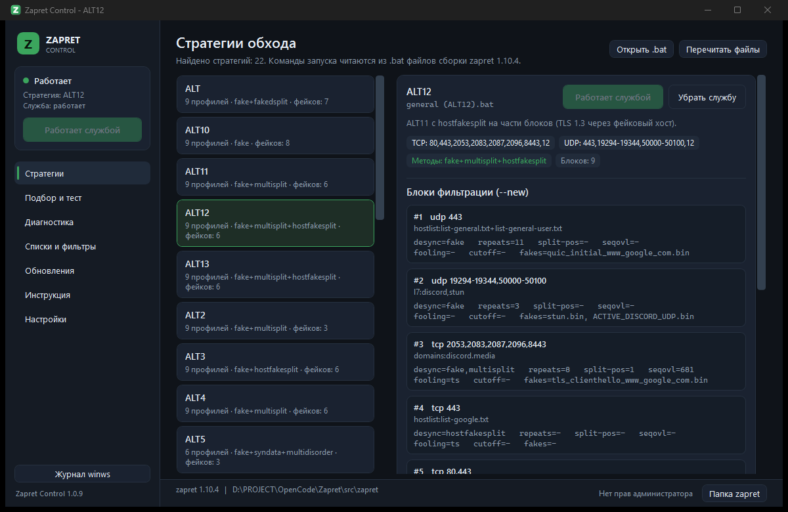
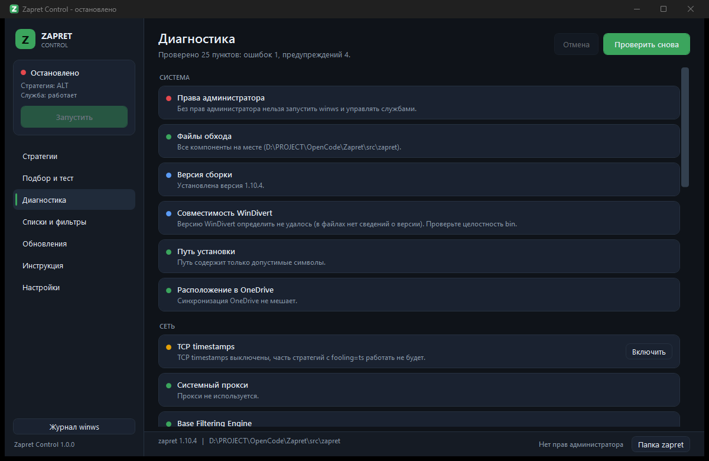

# Zapret Control

> **Zapret Control не является средством обхода.** Это только графическая оболочка для проекта [Flowseal/zapret-discord-youtube](https://github.com/Flowseal/zapret-discord-youtube), который использует движок [zapret](https://github.com/bol-van/zapret). Приложение не содержит собственного механизма обхода, не является VPN, прокси или сервисом и не передаёт трафик через сторонние серверы. Оно лишь запускает `winws.exe` из вашей папки со сборкой zapret с теми же аргументами, что и её bat-файлы.

Графическое приложение для сборки [Flowseal/zapret-discord-youtube](https://github.com/Flowseal/zapret-discord-youtube): запускает `winws.exe`, ставит стратегию в автозапуск, подбирает рабочую конфигурацию, проверяет систему и обновляет сборку прямо из GitHub.

Подробный разбор самой сборки, её истории и механизма обновления: [docs/ANALYSIS.md](docs/ANALYSIS.md).



## Скачать готовую сборку

В [Releases](https://github.com/anteaterantibus-tech/GUI_for_Zapret/releases) два файла, оба без стратегий и без сборки zapret:

- `ZapretControl-<версия>-Portable.exe`: портативная оболочка, рядом нужна папка zapret.
- `ZapretControl-<версия>-Setup-Shell.exe`: установщик только оболочки, ставит приложение и ярлыки.

1. Скачайте zapret-discord-youtube: https://github.com/Flowseal/zapret-discord-youtube/releases/latest
2. Распакуйте архив в папку без кириллицы в пути.
3. Запустите `ZapretControl-<версия>-Portable.exe` рядом с папкой zapret или установите `Setup-Shell` и укажите папку сборки в «Настройках».
4. Подтвердите запрос администратора.

Портативный exe показывает `Zapret Control Portable` в заголовке окна.

Примечания:

* Архив, скачанный из интернета, Windows может помечать как заблокированный. Перед распаковкой: правой кнопкой по zip, «Свойства», «Разблокировать».
* SmartScreen при первом запуске: «Подробнее», «Выполнить всё равно». Это ожидаемо для неподписанного приложения.
* Антивирус может реагировать на `WinDivert64.sys` в папке zapret: это компонент перехвата трафика, а не вирус.

## Что умеет

| Раздел | Возможности |
|---|---|
| **Стратегии** | все стратегии сборки с разбором блоков (порты, фильтры, desync, фейки), запуск и перезапуск, статус, время работы, журнал winws; импорт и экспорт выбранных стратегий в папку или zip |
| **Автозапуск** | установка любой стратегии как службы Windows `zapret`, удаление службы, восстановление после обновления |
| **Подбор и тест** | перебор стратегий с проверкой Discord, YouTube, Google, Cloudflare, Telegram, DNS; HTTP/1.1, TLS 1.2, TLS 1.3, ping, DPI-тест блока 16-20 КБ, UDP-STUN для голоса и загрузка файла с CDN YouTube; колонки «Ошибки» и «Качество», равноценные кандидаты |
| **Диагностика** | 25 проверок: BFE, прокси, TCP timestamps (с исправлением), Adguard, Killer, Intel, Check Point, SmartByte, VPN, hosts, DoH, DNS, остаточный WinDivert, конфликты обходов, кэш Discord, версия и целостность WinDivert |
| **Списки** | редактор всех 9 файлов `lists` (мои списки и списки сборки), GameFilter с включением одной кнопкой, режимы IPSet, загрузка своих списков файлами или папкой, обновление hosts, «Не обходить YouTube», «Discord: текст и сайт» |
| **Обновления** | проверка релиза, список изменений, скачивание и установка, резервные копии и откат, сохранение пользовательских данных |
| **Инструкция** | краткая памятка внутри приложения и подробное PDF-руководство |



## Документация

* Краткая инструкция: раздел «Инструкция» внутри приложения (открывается при первом запуске).
* Подробное руководство без технических деталей: [docs/Руководство.pdf](docs/Руководство.pdf) (22 страницы, со скриншотами). Копируется рядом с exe при установке и открывается кнопкой «Подробное руководство (PDF)».
* Разбор самой сборки и истории версий: [docs/ANALYSIS.md](docs/ANALYSIS.md).

## Установка (необязательно)

Приложение работает как portable: достаточно запустить exe. Если нужны ярлыки и отдельная папка установки:

1. Соберите `dist` (см. ниже).
2. Запустите `install.cmd`: приложение копируется в `%LOCALAPPDATA%\ZapretControl`, создаются ярлыки в меню «Пуск» и на рабочем столе с иконкой приложения, рядом копируется PDF-руководство.
3. Удаление: `uninstall.cmd`. Служба zapret и пользовательские настройки при этом не удаляются.

Иконка встроена в exe (`src/Zapret.App/app.ico`), она же используется для ярлыков и трея. Пересоздать иконку: `powershell -File tools\make-icon.ps1`.

## Правило сборки: ярлык на рабочем столе

После любой сборки, которая обновляет `release\`, создаётся или обновляется ярлык **«Zapret Control»** на рабочем столе:

- имя ярлыка всегда без версии;
- цель - свежий `release\ZapretControl-<версия>-Portable.exe`, не `dist\`, не Setup.exe и не установленная копия;
- реализация: `tools\update-shortcut.ps1`;
- вызывается автоматически из `make-portable.ps1`, `make-release.ps1` и `make-setup.ps1`;
- отключить на один запуск: `-NoDesktopShortcut`.

Это же правило зафиксировано в [AGENTS.md](AGENTS.md). Пакет `release\ZapretControl-<версия>.zip` и установщик всегда собираются из чистого релиза zapret, а не из рабочей папки `src\zapret`, поэтому пользовательские списки и резервные копии в поставку не попадают.

## Хранение версий

В `release\` лежит только текущая версия. Предыдущие автоматически переносятся в `release\backup\<версия>\`:

```
release\
  ZapretControl-<текущая>-Portable.exe
  ZapretControl-<текущая>-Setup.exe
  ZapretControl-<текущая>.zip
  ZapretControl-<текущая>\
  backup\
    <предыдущая>\
    <позапрошлая>\
```

Хранятся две последние версии до текущей, более старые удаляются. Очистка выполняется скриптом `tools\cleanup-release.ps1`, который вызывают все три скрипта сборки. После выпуска 1.0.14 в бэкапе лежат 1.0.13 и 1.0.12, версия 1.0.11 удалена. При выпуске 1.0.15 там останутся 1.0.14 и 1.0.13.

## Требования

* Windows 10/11 x64.
* Права администратора: приложение запускается с манифестом `requireAdministrator`, без них winws и службы недоступны.
* Папка с распакованной сборкой zapret (там, где `bin\winws.exe`). Приложение не содержит бинарников и работает поверх вашей папки.

## Сборка

Нужен .NET SDK 9.0:

```
dotnet build src\Zapret.App\Zapret.App.csproj -c Release
```

Публикация одним exe:

```
dotnet publish src\Zapret.App\Zapret.App.csproj -c Release -r win-x64 --self-contained true ^
  -p:PublishSingleFile=true -p:IncludeNativeLibrariesForSelfExtract=true -o dist
```

Готовые портативные файлы с версией в имени создаются скриптом:

```
powershell -File tools\make-portable.ps1
```

Он кладёт их и в `dist`, и в `release`:

```
dist\ZapretControl-<версия>.exe              обычная сборка для установщика
dist\ZapretControl-<версия>-Portable.exe     портативная, self-contained
release\ZapretControl-<версия>-Portable.exe  копия для передачи
```

Портативная сборка отличается только именем файла: суффикс `-Portable` включает слово Portable в заголовке окна и в трее.

Второй вариант сборки, без встроенного рантайма, больше не выпускается.

## Первый запуск

1. Запустите `ZapretControl-<версия>-Portable.exe` (или ярлык после установки) и подтвердите UAC.
2. Если сборки рядом нет, приложение предложит скачать свежую версию из GitHub в `%LOCALAPPDATA%\ZapretControl\zapret` или указать папку вручную.
3. Откройте «Подбор и тест», нажмите «Найти лучшую». Приложение по очереди запустит стратегии и покажет результат.
4. Запустите лучшую (двойной щелчок по строке) или выберите её в «Стратегиях».
5. Для автозапуска нажмите «В автозапуск» в карточке стратегии.

### Как читается оценка

* Сначала смотрите на «Ошибки»: 100 за проверку и −100 за отказ, поэтому стратегия с ошибкой не должна обгонять чистую.
* Блок 16-20 КБ штрафуется сильнее одной проверки: это прямой признак обрыва видео.
* UDP проверяет, проходит ли голос Discord, видео - реальную загрузку с CDN YouTube.
* «Качество» - процент от максимума при текущем наборе проверок, удобно сравнивать строки одного запуска.
* Сортировка: сначала класс без ошибок и блокировок, затем оценка.
* Если верхние строки в пределах 50 баллов, приложение пишет «равноценные кандидаты»: проверьте 2-3 стратегии вручную, разница в пределах погрешности.

### Если YouTube виснет с обходом

В «Списках и фильтрах» есть блок «YouTube и обход»:

* «Не обходить YouTube» - убирает домены YouTube из `list-google.txt` (с резервной копией) и добавляет их в `list-exclude-user.txt`. YouTube идёт напрямую, Discord остаётся под обходом. Обход перезапускается автоматически.
* «Вернуть обход YouTube» - восстанавливает `list-google.txt` из копии и удаляет добавленные исключения.

Это помогает, когда видео долго запускается, замирает на несколько секунд и снова идёт, а без обхода YouTube работает нормально: значит стратегия мешает именно видео.

Рядом есть карточка «Discord: текст и сайт». Она выключает обход доменов Discord, если сайт или текст мешают. Голосовой UDP-профиль остаётся: он работает по портам, а не по доменам.

### Загрузка своих списков

В «Списках и фильтрах» есть кнопки «Загрузить файлы...» и «Загрузить папку...». Приложение берёт файлы с теми же именами, что в `lists`, и объединяет их с текущими: новые строки добавляются, дубликаты убираются, папка `lists` сохраняется в резервную копию. После импорта обход перезапускается.

## Обновление сборки

Вкладка «Обновления»:

* версия установленной сборки читается из `LOCAL_VERSION` в `service.bat`;
* последний релиз берётся из GitHub API, архив `zapret-discord-youtube-<версия>.zip` скачивается встроенно;
* перед заменой создаётся полная резервная копия в `../zapret-backups/`;
* файлы в `lists` по умолчанию **объединяются**, а не перезаписываются: ваши правки сохраняются, новые строки из релиза добавляются, удалённые в релизе строки убираются только если вы их не меняли;
* режим можно переключить в «Параметрах обновления»: объединить, заменить новыми, оставить мои;
* сохраняются `lists/*-user.txt`, режим IPSet, `game_filter.enabled`, отключённая автопроверка обновлений и заменённые `ACTIVE_*.bin`;
* после установки перечитываются стратегии, восстанавливается служба и запускается та же стратегия, если она работала;
* при ошибке выполняется откат из резервной копии;
* если папки сборки ещё нет, приложение скачает и развернёт её в выбранный каталог.

Автоматическая установка включается в «Настройках»: «Устанавливать обновления автоматически при запуске». В этом режиме приложение само скачивает и ставит новую версию, а затем перезапускает стратегию (если она работала). Без этой галочки приложение только сообщает о новой версии.

## Права администратора

Приложение собрано с манифестом `requireAdministrator`, поэтому Windows сама запрашивает UAC при запуске. Если процесс всё же стартовал без прав (например, его запустил сторонний лаунчер, потерявший манифест), приложение перезапускает себя через `runas`. В нижней строке окна видно предупреждение, если права так и не получены. Для отладки интерфейса без UAC есть ключ `--no-elevate`.

Автопроверка обновлений включается в настройках и не мешает запуску: при недоступности GitHub приложение просто продолжает работать.

## Проверки

Консольный проект `src/Zapret.Check` проверяет парсер и ядро без запуска GUI:

```
dotnet run --project src\Zapret.Check -c Release -- src\zapret
```

Проверяется: разбор всех 22 стратегий, round-trip командной строки (ни один аргумент не теряется), версии, GameFilter-диапазоны, подстановка `%BIN%`, `%LISTS%`, `%GameFilterTCP%`.

Полный тест обновления (скачивает релиз, ставит на временную копию и проверяет сохранность данных):

```
dotnet run --project src\Zapret.Check -c Release -- src\zapret --update-test
```

Тест не трогает службу `zapret`, если она указывает на другую папку.

## Структура

```
src/Zapret.Core    парсер стратегий, запуск winws, служба, диагностика, тесты, апдейтер
src/Zapret.App     WPF-интерфейс (тёмная тема, трей, 7 разделов)
src/Zapret.Setup   компактный установщик: распаковывает встроенный архив и ставит приложение
src/Zapret.Check   консольные проверки ядра и апдейтера
src/zapret         распакованная сборка zapret для разработки и тестов
docs/              анализ, руководство (HTML + PDF), скриншоты
tools/             установщик, генератор иконки, сборка релиза, снятие скриншота окна
install.cmd        установка ярлыков из папки (dev)
uninstall.cmd      удаление установленной копии
release/           готовые артефакты: папка, zip и Setup.exe
```

Настройки хранятся в `%APPDATA%\ZapretControl\settings.json`, журналы winws в `%APPDATA%\ZapretControl\logs`.

## Ограничения

* Приложение не является VPN и не передаёт трафик через сторонние серверы: оно запускает `winws.exe` из вашей папки с теми же аргументами, что и bat-файлы.
* Обновляется только upstream-сборка. Самообновление приложения появится, когда у проекта будут свои релизы (заготовка: `AppInfo.SelfRepo`).
* Одновременно может работать только один экземпляр winws. Если стратегия установлена как служба, ручной запуск блокируется до удаления службы.
* Антивирус может реагировать на `WinDivert64.sys`: это компонент перехвата трафика, а не вирус.

## Лицензия

Код приложения в этом репозитории можно использовать свободно. Сама сборка zapret распространяется по MIT (copyright bol-van, Flowseal), бинарники берутся из их релизов.
